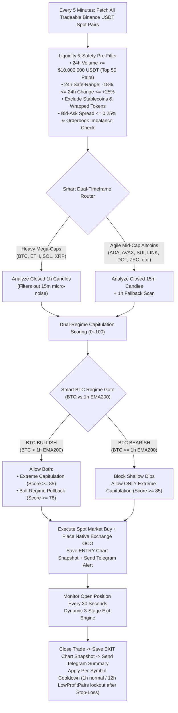

# CryptoBot — Automated Binance Spot Capitulation & Mean-Reversion Engine

An automated, non-custodial **Binance Spot** trading bot written in Python. Instead of chasing overextended green breakout candles at the top of a move, **CryptoBot** scans the top 50 most liquid USDT pairs every 5 minutes using a **Smart Dual-Timeframe (`15m` + `1h`) Capitulation Engine** to buy extreme panic flushes (`RSI <= 20–25`, below Lower Bollinger Band `BB(20, 2.0)`, stretched below `EMA21` on climactic volume) and lock in the mean-reversion rebound using a **Dynamic 3-Stage Exit Engine**.

---

## 1. How the Bot Operates (End-to-End Workflow)



---

## 2. Core Strategy & Risk Architecture

### A. Smart Dual-Timeframe Detection (`15m` + `1h`)
Different crypto assets move at different speeds:
- **Mega-Cap Anchors (`BTCUSDT`, `ETHUSDT`, `SOLUSDT`, `XRPUSDT`):** Evaluated exclusively on closed **`1h` candles** (`ONE_HOUR_ONLY_SYMBOLS`). Because mega-caps have `$100B–$1.5T` market caps, `15m` dips are often mid-move noise, whereas `1h` capitulation candles capture true multi-hour exhaustion.
- **Agile Mid-Cap Altcoins:** Evaluated on closed **`15m` candles** first for rapid intraday flushes, with an automatic **`1h` fallback** if the `15m` scan doesn't trigger.

### B. Two-Tier Capitulation Entry Scoring (`scanner.py`)
All indicators are computed strictly on the **last closed candle (`iloc[-2]`)** to eliminate intrabar repainting and lookahead bias:
1. **Tier 1 — Extreme Capitulation (`Score = 85` + up to `+5` Orderbook Bonus):**
   - `Close <= Lower Bollinger Band(20, 2.0)`
   - `RSI(14) <= 20` (deep panic exhaustion)
   - `Stretch below EMA21 >= 3.2%` (`15m`) or `>= 4.0%` (`1h`)
   - `Volume >= 2.0x` 20-bar average volume (climactic selling spike)
   - *Allowed in both Bullish and Bearish BTC regimes.*
2. **Tier 2 — Bull-Regime Capitulation Dip (`Score = 78` + up to `+5` Orderbook Bonus):**
   - Coin is in a macro uptrend (`Close >= 0.992 * EMA200`)
   - `Close <= Lower Bollinger Band(20, 2.0)`
   - `RSI(14) <= 25` (`15m`) or `<= 26` (`1h`)
   - `Stretch below EMA21 >= 2.0%`
   - `Volume >= 1.5x` 20-bar average volume
   - *Allowed only when `BTCUSDT` is above its `1h EMA200` (`BULLISH` regime).*

### C. Dynamic 3-Stage Exit Engine (`risk_manager.py`)
Instead of using a tight `-1.5%` stop-loss that gets hunted by normal crypto wicks and a greedy `+6%` target that rarely hits, the bot manages risk dynamically across three stages:
1. **Stage 1 — Wide Initial Catastrophe Bracket + Exchange OCO:**
   - Places an ATR-scaled catastrophe Stop-Loss (`4.8x ATR`, clamped to `1.5%–7.0%`) and Take-Profit (`2.0x ATR`, floored at `1.8%`) directly on Binance's matching engine via a native **OCO (One-Cancels-the-Other)** order (`USE_EXCHANGE_OCO = True`). Even if your server loses internet, your position is protected on Binance.
2. **Stage 2 — Fast Risk Elimination (Break-Even & Trailing Stop):**
   - **Trailing Stop (`+1.8%` effective trigger, `0.7%` offset):** Once profit reaches `+1.8%` (`MIN_TRAILING_PROFIT_PCT + ROUND_TRIP_FEE_PCT`), a tight `0.7%` trailing stop arms to follow the rebound upward.
   - **Break-Even Lock (`+2.2%` trigger + OCO Sync):** Once profit reaches `+2.2%`, the Stop-Loss floor is automatically raised above your entry price (`entry * 1.003`, covering `0.20%` round-trip fees plus a `0.10%` slippage allowance) and **synchronized with your exchange-side OCO order on Binance**.
   - **Time-Decaying `EMA21` Profit-Take (`minimal_roi` style):** If a candle closes back above `EMA21` with `>= +1.2%` profit in the first 45m (`2h` on `1h` trades) — or `>= +0.55%` profit after 45m (`2h` on `1h` trades) once `EMA21` has drifted lower — the bot banks the mean-reversion gain immediately.
3. **Stage 3 — Time & Trend Invalidation (`8h` / `16h`):**
   - If a position has been open for `8 hours` (`MAX_SCANNER_HOLD_HOURS`) and the last closed candle is still below `EMA21`, it exits early (`TREND_INVALIDATED`) rather than waiting for the catastrophe stop. Hard maximum hold time is `16 hours` (`MAX_HOLD_TIMEOUT`).

### D. Portfolio Circuit Breakers & Protections
- **24h Safe-Dump & Parabolic Guard:** Blocks coins that have crashed more than `-18%` in 24h (`MAX_24H_DUMP_PCT = -18.0`, protecting against hacks/delistings/falling knives) or pumped more than `+25%` (`PARABOLIC_PUMP_MAX_PCT = 25.0`).
- **Per-Symbol Cooldown (`LowProfitPairs` Protection):** `1 hour` cooldown after a normal exit; extended to **`12 hours` (`43,200s`)** after a `STOP_LOSS` to prevent re-entering a bleeding coin on the same day.
- **Consecutive Loss Pause:** Pauses scanning for `30 minutes` after `2` consecutive stop-losses.
- **Daily Circuit Breaker:** Halts new entries for the rest of the UTC day if daily portfolio drawdown reaches `6%` (`MAX_DAILY_LOSS = 6`).

---

## 3. Validated 90-Day Multi-Coin Performance

Tested across the 15-coin liquid basket (`BTC`, `ETH`, `BNB`, `SOL`, `XRP`, `ADA`, `AVAX`, `DOT`, `LINK`, `POL`, `NEAR`, `ATOM`, `APT`, `SUI`, `ARB`) with realistic round-trip friction (`0.10%` fee/side + `0.05%` slippage/side = **`0.30%` round-trip cost**):

### A. Cross-Asset Signal Breadth (Independent Symbol Backtests)
| Metric | Old Breakout Bot (v5) | **New Dual-Timeframe Capitulation Bot** |
|---|---|---|
| **Profitable Coins in Basket** | `0 / 15` (`0%`) | **`14 / 15` (`93%` — `BROAD EDGE ✓`)** |
| **Overall Win Rate** | `18% – 28%` | **`84.5%` (`82` Wins / `15` Losses across `97` trades)** |
| **Pooled Profit Factor** | `0.34` | **`3.05` (`+$73.75` unconstrained net P&L)** |
| **Median Expectancy / Trade** | `-1.12%` | **`+0.87%` net per trade** |

### B. Shared-Capital Portfolio Simulation (`MAX_OPEN_TRADES = 1`, `$1,000` Capital, `$100` / Trade)
Simulating the live 1-position-at-a-time constraint chronologically across all 15 coins with bar-by-bar Mark-to-Market drawdown accounting ([`validation_results/basket_15m_90d.json`](validation_results/basket_15m_90d.json)):
- **Trades Executed:** `33` taken (`64` concurrent signals skipped due to `MAX_OPEN_TRADES = 1`)
- **Portfolio Net Return:** **`+1.24%`** (`+$12.40` -> `$1,012.40` final equity; note `$100` / trade = `10%` position sizing)
- **Mark-to-Market Max Drawdown:** **`1.24%`** (vs `0.89%` realized-only)

> *Note: OHLCV backtests omit live L2 spread (`<= 0.25%`), order-book depth imbalance, and cross-pair BTC `1h EMA200` filtering.*

---

## 4. Repository Structure

| File | Purpose |
|---|---|
| `bot.py` | Main daemon entry point (`ScannerEngine`: 5-minute market scan thread + 30-second position monitor thread). |
| `scanner.py` | Dual-Timeframe (`15m` + `1h`) market scanner, closed-candle BTC `1h EMA200` regime filter (fail-closed), spread filter (`<= 0.25%`), and Capitulation scoring engine. |
| `risk_manager.py` | Position tracking (`positions.json`), partial-fill reconciliation, ATR stop/TP computation, Break-Even lock, Trailing Stop, `EMA21` exit, and UTC circuit breakers. |
| `exchange.py` | Binance Spot API connector (`python-binance`). Uses idempotent `newClientOrderId` order reconciliation (`NEW`/`EXPIRED`/timeout recovery) and live public market data for scanning when running on Testnet (`USE_TESTNET=True`). |
| `config.py` | Central configuration file for strategy modes, timeframes, risk limits, and indicator parameters (defaults safely to `USE_TESTNET=True`). |
| `notifier.py` | Telegram `MarkdownV2` notifications (includes DST-aware `Europe/Belgrade` `Opened`/`Closed` execution timestamps, `[15m]`/`[1h]` timeframe tag, estimated hold window, `%` and `USDT` P&L, and duration). |
| `chart_logger.py` | Automatically saves dark-themed PNG candlestick/indicator charts (`Price`, `EMA9/21/50`, `Lower BB(20,2)`, `RSI`, `MACD`, `Entry/Exit/SL/TP`) to `charts/`. |
| `scan_logger.py` | Logs top scan candidates and tracks empirical 1h/4h forward returns in `scan_logs.json`. |
| `check_perms.py` | Diagnostic CLI tool to verify Binance API keys, server time sync, Spot trading permissions, and account balances. |
| `backtest.py` | Single-symbol and multi-symbol quantitative backtester with Monte Carlo random-entry baseline comparison. |
| `validate.py` | Out-of-sample validation suite (`walk_forward`, `basket` with Mark-to-Market portfolio drawdown, `monte_carlo`, `slippage`). |
| `experiment.py` | Gate 0 accounting & no-lookahead verification harness + Stage A strategy family comparison suite. |
| `tests/test_patches.py` | 44 automated unit tests covering idempotent order reconciliation (`NEW`/`EXPIRED`), partial-sell & dust reconciliation, failed-sell protection, persistent OCO break-even sync retries, spread/regime filters, DST timestamps, and MTM drawdown invariants. |
| `deploy/` | `vps_setup.sh` (automated Ubuntu 22.04/24.04 installer) and `cryptobot.service` (`systemd` 24/7 background daemon config). |

---

## 5. Running Backtests & Unit Tests Locally

```bash
# 1. Create virtual environment and install dependencies
python -m venv .venv
# Windows PowerShell:
.\.venv\Scripts\pip install -r requirements.txt
# Linux / macOS:
./.venv/bin/pip install -r requirements.txt

# 2. Run the 44 unit tests & Gate 0 accounting audit
python -m unittest discover -s tests -v

# 3. Run the 15-coin Dual-Timeframe basket validation (90 days)
python validate.py basket --days 90 --interval 15m --baseline 5

# 4. Run Walk-Forward, Monte Carlo, and Slippage stress tests
python validate.py all --symbol ADAUSDT --days 90 --interval 15m
```

---

## 6. 24/7 Ubuntu VPS Deployment (Testnet & Live Spot)

### One-Line Automated VPS Install
SSH into your Ubuntu 22.04 / 24.04 VPS and run:
```bash
git clone https://github.com/lrk37/CryptoBot.git ~/CryptoBot && cd ~/CryptoBot && bash deploy/vps_setup.sh
```

### Configuring `.env` (Testnet vs. Live)
Open your environment file:
```bash
nano ~/CryptoBot/.env
```
- **For Risk-Free Testing on Binance Spot Testnet (`USE_TESTNET=True`):**
  Generate keys at **https://testnet.binance.vision/** (Log in with GitHub $\rightarrow$ *Generate HMAC_SHA256 Key*):
  ```ini
  USE_TESTNET=True
  BINANCE_TESTNET_API_KEY=your_testnet_key
  BINANCE_TESTNET_API_SECRET=your_testnet_secret
  ```
- **For Real Money on Binance Live Spot (`USE_TESTNET=False`):**
  Generate keys at **https://www.binance.com/en/my/settings/api-management** (enable *Spot & Margin Trading*, keep *Withdrawals* disabled, and whitelist your VPS IPv4 from `curl -4 ifconfig.me`):
  ```ini
  USE_TESTNET=False
  BINANCE_API_KEY=your_live_binance_key
  BINANCE_API_SECRET=your_live_binance_secret
  ```

### Verify Keys & Manage the 24/7 Service
```bash
# 1. Verify API key connectivity, permissions & balances
cd ~/CryptoBot && ./venv/bin/python check_perms.py

# 2. Start & enable the 24/7 background service
sudo systemctl start cryptobot
sudo systemctl status cryptobot

# 3. Watch live scanning & trade logs
tail -f ~/CryptoBot/bot.log

# 4. View saved trade charts, open positions & trade history
ls -la ~/CryptoBot/charts/
cat ~/CryptoBot/positions.json
cat ~/CryptoBot/trade_log.json

# 5. Pull latest code updates from GitHub & restart
cd ~/CryptoBot && git pull origin main && sudo systemctl restart cryptobot
```
