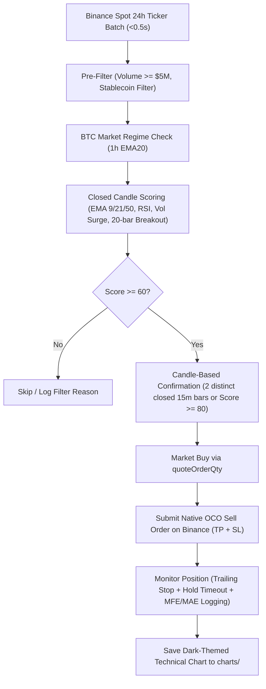

# CryptoBot — Quantitative Spot Momentum Engine for Binance

**CryptoBot** is a high-performance, quality-focused automated trading bot designed for Binance Spot. It continuously monitors all USDT trading pairs, executes volatility breakouts on closed 15m candles with multi-layer momentum confirmation, and protects capital using native exchange-side OCO stop-loss orders.

---

## ⚡ Highlights & Key Upgrades

- **Instant Market Scanning**: Replaced sequential HTTP polling with Binance's batch 24h ticker endpoint, reducing full-market scan time from ~145 seconds to **< 0.5 seconds**.
- **No Mid-Candle Repainting**: All indicator logic (EMA 9/21/50, RSI 14, Volume MA 20, 20-bar breakout) is calculated exclusively on **fully closed candles**, preventing false triggers on intra-candle wicks.
- **Native Exchange-Side OCO Protection**: Immediately upon entry, the bot submits a server-side **OCO (One-Cancels-the-Other)** bracket order directly to Binance. If the bot crashes, loses internet, or restarts, your capital remains 100% protected on the exchange.
- **Favorable Risk/Reward Tuning**: Initial Stop-Loss at 2.0% (or 2.5x ATR) and Take-Profit at 6.0% (or 5x ATR) targeting a **3:1 Reward-to-Risk ratio**, with dynamic break-even activation once profit reaches +2.0%.
- **Quantitative Backtester (`backtest.py`)**: Includes a complete historical backtesting suite that models realistic taker fees (0.1%), slippage (0.05%), and outputs Sharpe ratio, Sortino ratio, win rate, and max drawdown.
- **Production-Ready VPS & Docker Support**: Includes a ready-to-use `Dockerfile`, `docker-compose.yml`, Linux `systemd` service, and 1-click VPS installation script.

---

## 🏗️ Architecture & How It Works



---

## 🚀 Quick Start (Local)

### 1. Clone & Set Up Environment
```bash
git clone https://github.com/lrk37/CryptoBot.git
cd CryptoBot

python -m venv venv
# On Windows:
.\venv\Scripts\activate
# On Linux/macOS:
source venv/bin/activate

pip install -r requirements.txt
```

### 2. Configure Credentials
Copy `.env.example` to `.env` and fill in your Binance API keys:
```bash
cp .env.example .env
```
Edit `.env`:
```ini
BINANCE_API_KEY=your_api_key_here
BINANCE_API_SECRET=your_api_secret_here
USE_TESTNET=False
```

### 3. Check Permissions & Test Order
Run the diagnostic tools to verify connectivity and spot permissions:
```bash
python check_perms.py
python test_order.py
```

### 4. Run Backtest
Validate the strategy on historical data before trading:
```bash
python backtest.py --symbol SOLUSDT --days 60 --interval 15m
```

### 5. Launch Bot
```bash
python bot.py
```

---

## ☁️ Cloud VPS Deployment (24/7 Hosting)

For unattended 24/7 operation on an Ubuntu Cloud VPS (e.g., Hetzner, DigitalOcean, Linode, AWS):

```bash
# Automated 1-Click Setup:
curl -sSL https://raw.githubusercontent.com/lrk37/CryptoBot/master/deploy/vps_setup.sh | bash
```

See [`VPS_GUIDE.md`](VPS_GUIDE.md) for full instructions covering `systemd` service management, Docker deployment, and API security.

---

## 📊 Quantitative Metrics & Trade Log

Every closed trade is saved with auditable metrics to `trade_log.json`:

```json
{
  "timestamp": "2026-10-19T14:30:00+00:00",
  "symbol": "SOLUSDT",
  "kind": "scanner",
  "entry_price": 162.40,
  "exit_price": 172.14,
  "quantity": 0.12,
  "pnl_pct": 6.00,
  "pnl_usdt": 1.17,
  "mfe_pct": 6.15,
  "mae_pct": -0.42,
  "raw_score": 90.0,
  "pump_penalty": 0.0,
  "final_score": 90.0,
  "reason": "TAKE_PROFIT",
  "hold_duration_sec": 3600
}
```

---

## 🛡️ Risk Management Matrix

| Rule | Configuration | Action Taken |
| :--- | :--- | :--- |
| **Stop Loss** | `SCANNER_STOP_LOSS_PCT = 2.0%` | Server-side OCO stop order on Binance |
| **Take Profit** | `SCANNER_TAKE_PROFIT_PCT = 6.0%` | Server-side OCO limit order on Binance |
| **Break-Even Stop** | `BREAK_EVEN_TRIGGER_PCT = 2.0%` | Raises SL to entry + 0.2% round-trip fees |
| **Trailing Stop** | `MIN_TRAILING_PROFIT_PCT = 2.5%` | Trailing offset 1.2% behind peak price |
| **Consecutive Losses** | `MAX_CONSECUTIVE_LOSSES = 2` | Pauses new scans for 30 minutes |
| **Daily Circuit Breaker** | `MAX_DAILY_LOSS = 6.0%` | Halts all trading if portfolio drops 6% in a day |
| **Symbol Cooldown** | `SYMBOL_COOLDOWN_SEC = 3600` | 1-hour cooldown per coin after trade close |

---

## 📜 Disclaimer
*Cryptocurrency trading involves substantial risk of loss. Always backtest strategies thoroughly and start with small position sizes or testnet funds. Never risk capital you cannot afford to lose.*
